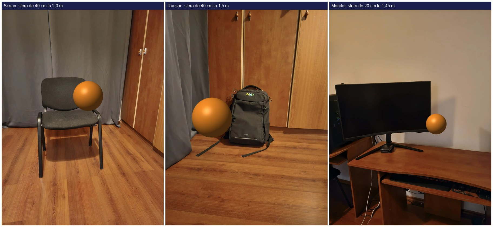
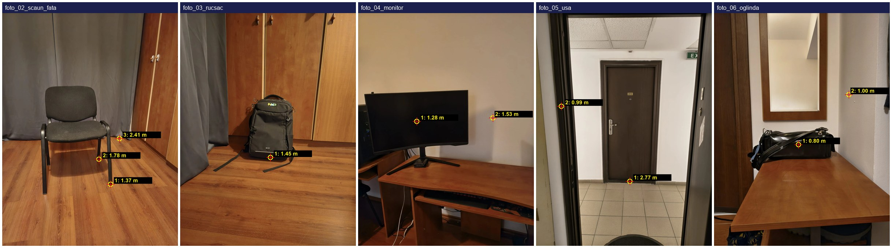

# Ocluzia-obiectelor-virtuale-in-imagini-reale-folosind-estimarea-adancimii
Proiectul abordeaza ocluzia in realitatea augmentata: obiectele virtuale apar peste cele reale cand ar trebui acoperite. Folosind modele de estimare a adancimii (Depth Anything, MiDaS), se decide pentru fiecare pixel daca obiectul real e in fata sau in spatele celui virtual. Se compara modelele pe imagini si video, evaluand calitatea ocluziei.

## Stadiu la Milestone 2

| Componentă | Responsabil | Stare |
| --- | --- | --- |
| Sprite 2.5D (PNG cu alfa + relief de adâncime), 3 primitive | P2 | gata, testat |
| Plasare: poziție (x, y), adâncime Z, scară, cu perspectivă | P2 | gata, testat |
| Test de ocluzie per pixel și mască binară per model | P2 | gata, testat |
| Ruta A (vot majoritar) și ruta B (vot ponderat) | P2 | gata, testat |
| Ruta B-soft (vot ponderat cu margine), propunere | P2 | gata, testat |
| Compunere AR și panouri side-by-side | P2 | gata, testat |
| Fotografii proprii: 6 poze și puncte de control măsurate cu ruleta | P2 | gata |
| Cele 3 modele de adâncime, aliniate în metri | P1 | de adăugat |
| Rezultate pe imagini reale (NYU Depth V2, fotografii proprii) | P1 + P2 | după hărțile de adâncime |

Deocamdată rezultatele din `outputs/` vin dintr-o scenă sintetică și din modele de adâncime simulate. Ele verifică lanțul de prelucrare, nu sunt rezultate ale proiectului.


## Structură

```
ooviri/
  camera.py      camera pinhole: câți pixeli are un metru la o adâncime dată
  sprite.py      obiectul virtual 2.5D: sferă, cub, cilindru; salvare PNG + relief
  placement.py   plasarea în imagine și plasări aleatoare reproductibile
  occlusion.py   testul de ocluzie per pixel
  voting.py      rutele A, B și B-soft
  compose.py     imaginea AR, suprapuneri de măști, panouri cu etichete
  pipeline.py    tot lanțul pentru o imagine + salvarea rezultatelor
  depthio.py     citire și scriere de imagini și hărți de adâncime
  metrics.py     IoU și F1 pe măști (auto-verificare; evaluarea completă e la P1)
  measure.py     puncte de control măsurate cu ruleta, pentru fotografiile proprii
  synthetic.py   scenă sintetică și modele simulate, doar pentru dezvoltare și teste
  cli.py         linia de comandă
tests/           47 de teste automate
docs/img/        imagini pentru README
data/            fotografiile proprii sunt în Git; restul datelor sunt locale (vezi data/README.md)
```

## Instalare

```bash
python -m venv .venv
.venv\Scripts\python -m pip install -r requirements.txt
```

## Demo fără date externe

```bash
.venv\Scripts\python -m ooviri demo
```

Scrie în `outputs/demo_sintetic/`: măștile binare (`masti/`), imaginile AR (`ar/`), trei panouri pentru fiecare caz (`panouri/`) și un raport JSON cu scorurile.

## Rulare pe o imagine reală

```bash
.venv\Scripts\python -m ooviri run --rgb data/rgb/0001.png --depth-root data/depth --id 0001 --gt data/gt/0001.npy --priors data/priors.json --sprite sphere --x 320 --y 260 --z 2.0 --out outputs/nyu
```

- `--depth-root` caută `data/depth/<model>/<id>.npy`; alternativ `--depth nume=cale`, repetat pentru fiecare model.
- `--gt` e opțional: dacă există, se calculează masca de referință, IoU și F1.
- `--camera fov --hfov 60` pentru fotografii proprii, unde nu știm parametrii camerei.
- `--sprite` acceptă `sphere`, `box`, `cylinder` sau `folder:nume` pentru un sprite salvat.

## Fotografii proprii

Cele șase poze sunt în `data/photos/`, împreună cu `masuratori.json`. Ce hărți de adâncime trebuie generate pentru ele și cum se folosesc măsurătorile este descris în [data/photos/README.md](data/photos/README.md).

```bash
.venv\Scripts\python -m ooviri preview --rgb data/photos/foto_02_scaun_fata.jpg --focal35 24 --x 800 --y 800 --z 2.0 --out outputs/foto/scaun.png
.venv\Scripts\python -m ooviri check --photo foto_02_scaun_fata
```

- `preview` desenează obiectul fără ocluzie, la mărimea corectă pentru adâncimea aleasă. Arată problema: sfera e la 2 m, în spatele scaunului, dar apare peste el.
- `check` afișează adâncimea așteptată în punctele măsurate și, cu `--depth model=cale.npy`, eroarea fiecărui model.
- `--focal35 24` este distanța focală echivalentă a telefonului; din ea rezultă câți pixeli are un metru la o adâncime dată.





## Contractul de date între P1 și P2

P2 primește, pentru fiecare imagine și fiecare model, o hartă de adâncime `float32`, în metri, aliniată, la rezoluția imaginii, salvată ca `.npy`. Structura folderelor și formatul `priors.json` sunt în [data/README.md](data/README.md).

## Rutele de vot

- **Ruta A, vot majoritar:** un pixel al obiectului e ocluzat dacă cel puțin 2 din 3 modele spun așa.
- **Ruta B, vot ponderat:** ca A, dar fiecare vot cântărește cât acuratețea modelului.
- **Ruta B-soft, vot ponderat cu margine:** fiecare model votează cu o încredere între 0 și 1, calculată din cât de departe e suprafața reală de cea virtuală, raportat la eroarea lui tipică.

Observație: cu trei modele și ponderi egale cu acuratețea, oricare două modele depășesc mereu al treilea, deci ruta B dă exact aceeași mască ca ruta A. Funcția `voting.same_as_majority` verifică asta pentru orice set de ponderi. De aceea am adăugat ruta B-soft, în care un model foarte sigur poate depăși două modele nesigure.

## Teste

```bash
.venv\Scripts\python -m pytest -q
```
