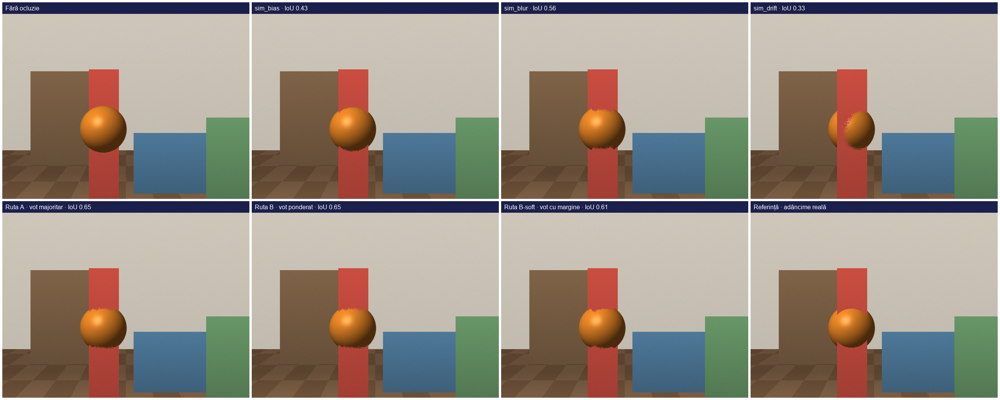
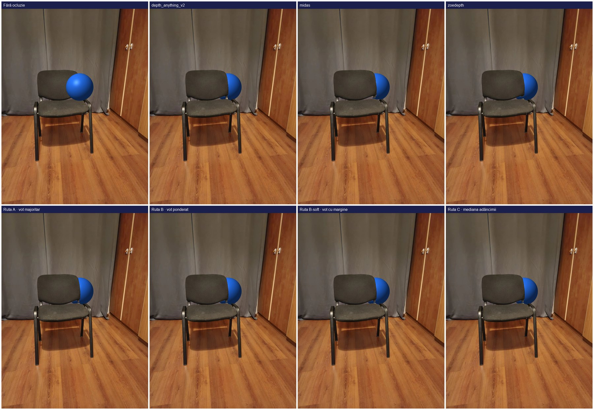
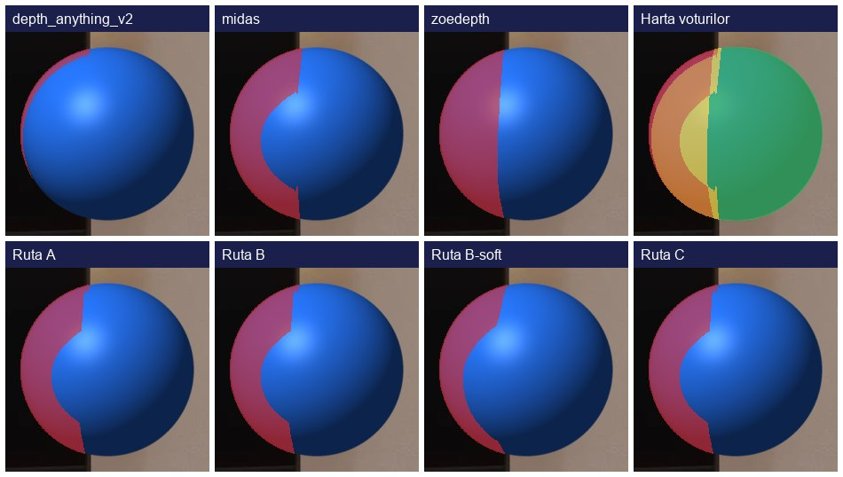

# Ocluzia-obiectelor-virtuale-in-imagini-reale-folosind-estimarea-adancimii
Proiectul abordeaza ocluzia in realitatea augmentata: obiectele virtuale apar peste cele reale cand ar trebui acoperite. Folosind modele de estimare a adancimii (Depth Anything, MiDaS), se decide pentru fiecare pixel daca obiectul real e in fata sau in spatele celui virtual. Se compara modelele pe imagini si video, evaluand calitatea ocluziei.

## Stadiu la Milestone 2

| Componentă | Responsabil | Stare |
| --- | --- | --- |
| Sprite 2.5D (PNG cu alfa + relief de adâncime), 3 primitive | P2 | gata, testat |
| Plasare: poziție (x, y), adâncime Z, scară, cu perspectivă | P2 | gata, testat |
| Test de ocluzie per pixel și mască binară per model | P2 | gata, testat |
| Ruta A (vot majoritar) și ruta B (vot ponderat) | P2 | gata, testat |
| Ruta B-soft (vot ponderat cu margine), propunere | P2 | gata, testat |
| Compunere AR și panouri side-by-side | P2 | gata, testat |
| Fotografii proprii: 6 poze și puncte de control măsurate cu ruleta | P2 | gata |
| Calibrarea scării pe puncte măsurate, pentru fotografiile proprii | P2 | gata, testat |
| Cele 3 modele de adâncime, aliniate în metri, și ruta C | P1 | gata, pe branch-ul `bogdan-p1` |
| Ocluzie pe fotografiile proprii, cu cele 3 modele și toate rutele | P1 + P2 | primele rezultate, mai jos |
| Evaluarea ocluziei pe NYU Depth V2 (IoU, F1) | P1 + P2 | urmează |

Demo-ul din `outputs/demo_sintetic` folosește o scenă sintetică și modele de adâncime simulate: verifică lanțul de prelucrare, nu este un rezultat al proiectului. Rezultatele pe imagini reale sunt în secțiunea „Rezultate pe fotografiile proprii”.



## Structură

```
ooviri/
  camera.py      camera pinhole: câți pixeli are un metru la o adâncime dată
  sprite.py      obiectul virtual 2.5D: sferă, cub, cilindru; salvare PNG + relief
  placement.py   plasarea în imagine și plasări aleatoare reproductibile
  occlusion.py   testul de ocluzie per pixel
  voting.py      rutele A, B și B-soft
  compose.py     imaginea AR, suprapuneri de măști, panouri cu etichete
  pipeline.py    tot lanțul pentru o imagine + salvarea rezultatelor
  depthio.py     citire și scriere de imagini și hărți de adâncime
  metrics.py     IoU și F1 pe măști (auto-verificare; evaluarea completă e la P1)
  measure.py     puncte de control măsurate cu ruleta, pentru fotografiile proprii
  synthetic.py   scenă sintetică și modele simulate, doar pentru dezvoltare și teste
  cli.py         linia de comandă
tests/           53 de teste automate
scripts/         harti_poze.py: hărțile de adâncime ale pozelor proprii, cu codul P1
config/          priors.json: ponderile și erorile modelelor, pentru rutele B și B-soft
docs/img/        imagini pentru README
data/            fotografiile proprii sunt în Git; restul datelor sunt locale (vezi data/README.md)
```

## Instalare

```bash
python -m venv .venv
.venv\Scripts\python -m pip install -r requirements.txt
```

## Demo fără date externe

```bash
.venv\Scripts\python -m ooviri demo
```

Scrie în `outputs/demo_sintetic/`: măștile binare (`masti/`), imaginile AR (`ar/`), trei panouri pentru fiecare caz (`panouri/`) și un raport JSON cu scorurile.

## Rulare pe o imagine reală

```bash
.venv\Scripts\python -m ooviri run --rgb data/rgb/0001.png --depth-root data/depth --id 0001 --gt data/gt/0001.npy --priors data/priors.json --sprite sphere --x 320 --y 260 --z 2.0 --out outputs/nyu
```

- `--depth-root` caută `data/depth/<model>/<id>.npy`; alternativ `--depth nume=cale`, repetat pentru fiecare model.
- `--gt` e opțional: dacă există, se calculează masca de referință, IoU și F1.
- `--camera fov --hfov 60` pentru fotografii proprii, unde nu știm parametrii camerei.
- `--sprite` acceptă `sphere`, `box`, `cylinder` sau `folder:nume` pentru un sprite salvat.

## Fotografii proprii

Cele șase poze sunt în `data/photos/`, împreună cu `masuratori.json`. Ce hărți de adâncime trebuie generate pentru ele și cum se folosesc măsurătorile este descris în [data/photos/README.md](data/photos/README.md).

```bash
.venv\Scripts\python -m ooviri preview --rgb data/photos/foto_02_scaun_fata.jpg --focal35 24 --x 800 --y 800 --z 2.0 --out outputs/foto/scaun.png
.venv\Scripts\python -m ooviri check --photo foto_02_scaun_fata
```

- `preview` desenează obiectul fără ocluzie, la mărimea corectă pentru adâncimea aleasă. Arată problema: sfera e la 2 m, în spatele scaunului, dar apare peste el.
- `check` afișează adâncimea așteptată în punctele măsurate și, cu `--depth model=cale.npy`, eroarea fiecărui model.
- `--focal35 24` este distanța focală echivalentă a telefonului; din ea rezultă câți pixeli are un metru la o adâncime dată.


## Rezultate pe fotografiile proprii

Hărțile de adâncime vin din codul P1 (`depth/`, branch-ul `bogdan-p1`), rulat pe cele șase poze: ZoeDepth dă metri, iar Depth Anything V2 și MiDaS sunt aliniate pe ZoeDepth.

**1. Scara în metri e supraestimată pe pozele noastre.** Față de punctele măsurate cu ruleta, hărțile dau cu 25% până la 85% mai mult, iar la scena de aproape, cu oglinda, peste 100%. Forma scenei e bună; greșită e scara. Cele trei modele greșesc la fel, pentru că două dintre ele moștenesc scara lui ZoeDepth.

**2. Două-trei puncte măsurate repară scara.** La `foto_02_scaun_fata`, care are trei puncte, calibrăm pe două și verificăm pe al treilea. Eroarea rămasă este de 1-2% la ZoeDepth, 3-7% la Depth Anything V2 și până la 16% la MiDaS. La ZoeDepth corecția este aproape o simplă scădere de circa 1 m. La `foto_05_usa`, cu cinci puncte, eroarea ZoeDepth la punctele de pe podea lăsate deoparte este tot de 1-2%; la tocul ușii, aflat mult mai aproape decât restul punctelor, urcă la 8%.

Măsurătorile se verifică și între ele: în `foto_05_usa`, pasul dintre liniile de gresie, dedus doar din poză, iese 0,29-0,30 m, față de 0,30 m măsurat.

**3. Pentru masca de ocluzie, rutele A, B și C dau același rezultat.** În toate cele opt cazuri de mai jos măștile lor sunt identice pixel cu pixel. Explicația este în secțiunea „Rutele de vot”. Doar B-soft diferă.

Cât din obiect este marcat ca ascuns, pe fiecare model și rută:

| Poză și caz | Depth Anything V2 | MiDaS | ZoeDepth | Rutele A, B, C | B-soft | Modelele se contrazic |
| --- | --- | --- | --- | --- | --- | --- |
| scaun din față, sferă după spătar | 48% | 50% | 47% | 48% | 48% | 4% |
| scaun din față, cub după picioare | 72% | 63% | 77% | 72% | 72% | 17% |
| scaun din lateral, sferă (necalibrat) | 0% | 16% | 0% | 0% | 0% | 16% |
| rucsac, sferă după rucsac | 16% | 14% | 19% | 16% | 18% | 6% |
| rucsac, sferă lângă perdea | 1% | 0% | 4% | 1% | 2% | 4% |
| monitor, sferă după monitor | 3% | 26% | 31% | 24% | 19% | 31% |
| ușă, sferă după toc | 53% | 55% | 56% | 55% | 55% | 3% |
| oglindă, sferă după geantă | 3% | 3% | 5% | 3% | 4% | 4% |

Pe fotografiile proprii nu există mască de referință, deci tabelul arată cât se contrazic modelele, nu cine are dreptate. Ultima coloană este partea din obiect pe care cele trei modele nu votează la fel.

Scaunul: fără ocluzie sfera apare peste spătar; cu ocluzie, spătarul o acoperă.



Monitorul, un caz greu: ecranul negru lucios e văzut diferit de fiecare model. Roșu = ascuns; în harta voturilor, galben și portocaliu = modelele se contrazic.



Reproducere:

```bash
.venv\Scripts\python scripts/harti_poze.py <folderul cu codul P1> data/photos data/depth
.venv\Scripts\python -m ooviri check --photo foto_02_scaun_fata --depth-dir data/depth
.venv\Scripts\python -m ooviri batch --placements data/photos/plasari.json --images data/photos --depth-dir data/depth --priors config/priors.json --measurements data/photos/masuratori.json --focal35 24 --out outputs/foto_real
```

- `scripts/harti_poze.py` face aceiași pași ca `depth.run` din codul P1, fără panoul desenat cu matplotlib, care pe unul dintre calculatoarele noastre e blocat de o politică Windows de control al aplicațiilor.
- `batch` calibrează fiecare model pe punctele măsurate ale pozei, alege adâncimea obiectului între două repere din poză (`z_intre` în `plasari.json`) și scrie măștile, imaginile AR, panourile și `rezumat.csv`.
- `config/priors.json` conține ponderi provizorii, luate din evaluarea P1 pe NYU.

## Contractul de date între P1 și P2

P2 primește, pentru fiecare imagine și fiecare model, o hartă de adâncime `float32`, în metri, aliniată, la rezoluția imaginii, salvată ca `.npy`. Structura folderelor și formatul `priors.json` sunt în [data/README.md](data/README.md).

## Rutele de vot

- **Ruta A, vot majoritar:** un pixel al obiectului e ocluzat dacă cel puțin 2 din 3 modele spun așa.
- **Ruta B, vot ponderat:** ca A, dar fiecare vot cântărește cât acuratețea modelului.
- **Ruta B-soft, vot ponderat cu margine:** fiecare model votează cu o încredere între 0 și 1, calculată din cât de departe e suprafața reală de cea virtuală, raportat la eroarea lui tipică.

- **Ruta C, fuziune la nivel de adâncime (P1):** mediana celor trei hărți, apoi un singur test de adâncime.

Două observații, verificate în teste și pe fotografiile proprii:

- **B = A.** Cu trei modele și ponderi egale cu acuratețea, oricare două modele depășesc mereu al treilea, deci ruta B dă exact aceeași mască ca ruta A. Funcția `voting.same_as_majority` verifică asta pentru orice set de ponderi.
- **C = A.** Mediana a trei adâncimi este în fața obiectului exact atunci când cel puțin două dintre ele sunt în față. Deci testul pe mediană dă aceeași mască ca votul majoritar. Ruta C rămâne o hartă de adâncime mai bună decât fiecare model, dar pentru ocluzie nu poate diferi de A.

De aceea am adăugat ruta B-soft, în care un model foarte sigur poate depăși două modele nesigure. Este singura dintre cele patru care poate schimba masca.

## Teste

```bash
.venv\Scripts\python -m pytest -q
```
