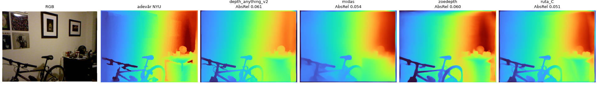
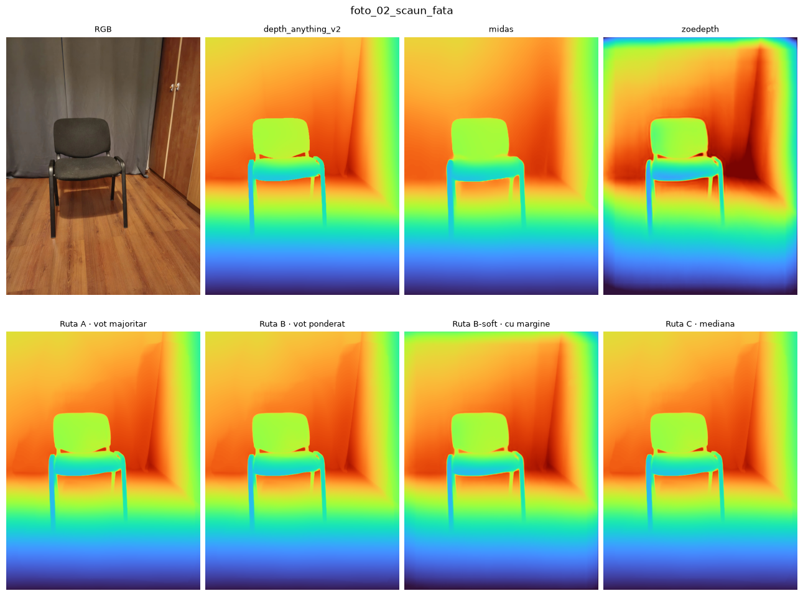
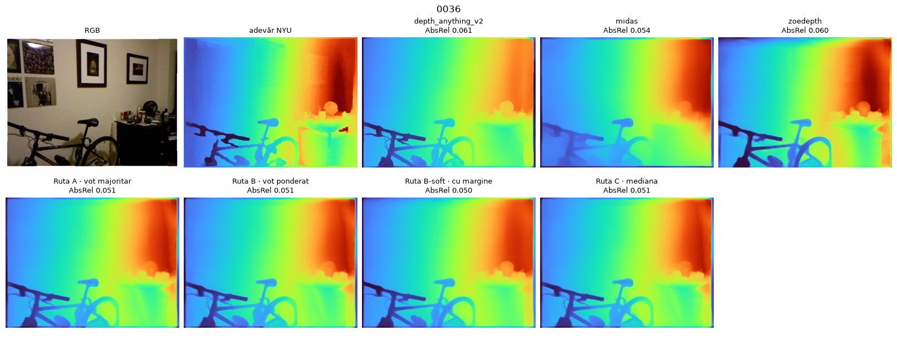
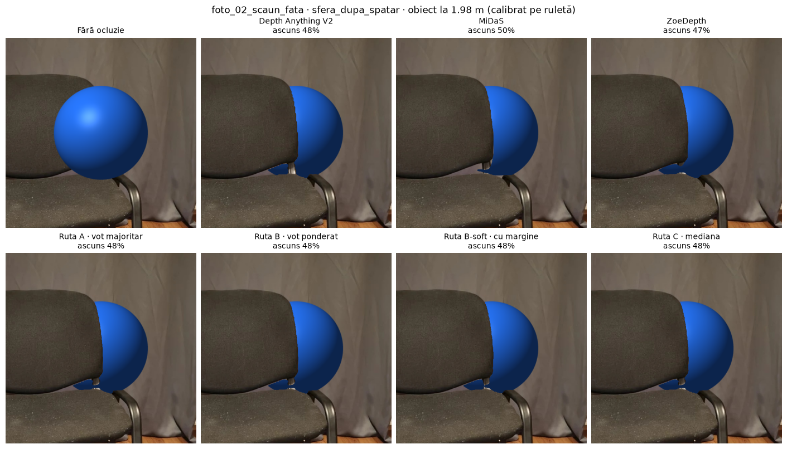

# OOVIRI – Ocluzia obiectelor virtuale în imagini reale folosind estimarea adâncimii

În realitatea augmentată, obiectele virtuale sunt desenate peste imagine chiar și când ar trebui ascunse în spatele unui obiect real mai apropiat. Proiectul estimează adâncimea scenei dintr-o singură imagine și decide, pixel cu pixel, ce e în față. Pentru că niciun model de adâncime nu e corect peste tot, decizia se ia prin votul a trei modele.

```
Imagine RGB → 3 modele de adâncime → aliniere în metri → vot / fuziune → ocluzie → imagine AR
```

**Echipa**
- P1: adâncime, vot, evaluare, demonstrator
- P2: compunere, ocluzie, vot, demonstrator

## Partea P1

### Ce s-a realizat

- **Cele 3 modele de adâncime rulează local, pe GPU:** Depth Anything V2 Small, MiDaS (DPT-Large) și ZoeDepth (NYU-KITTI).
- **Toate dau adâncime în metri.** ZoeDepth e metric. Depth Anything V2 și MiDaS dau disparitate relativă (fără unitate), care se aliniază la metri prin scară + offset (cele mai mici pătrate), pe adevărul NYU sau, pentru fotografii proprii, pe ZoeDepth.
- **Corecție pentru ZoeDepth:** padding-ul implicit din Hugging Face supraestima adâncimea cu ~25%; e dezactivat.
- **Ruta C – fuziune la nivel de adâncime:** mediana per pixel a celor 3 hărți aliniate.
- **Evaluare automată** pe toate cele 654 de imagini de test NYU Depth V2: AbsRel, RMSE, δ1 și timpul pe imagine, în crop-ul Eigen (ca în articole), în două moduri de aliniere.
- **Setul de date și modelele se descarcă automat** (un script pentru date, modelele la prima rulare).

### Rezultate (NYU Depth V2, 654 de imagini de test)

| Metodă | Aliniere | AbsRel ↓ | RMSE (m) ↓ | δ1 ↑ | s/imagine |
| --- | --- | --- | --- | --- | --- |
| Depth Anything V2 | adevăr | 0,086 | 0,365 | 0,935 | 0,019 |
| MiDaS | adevăr | 0,105 | 0,439 | 0,895 | 0,034 |
| ZoeDepth | – (metric) | 0,084 | 0,332 | 0,936 | 0,067 |
| **Ruta C** | adevăr | **0,075** | **0,327** | **0,950** | 0,121 |
| Depth Anything V2 | ZoeDepth | 0,105 | 0,432 | 0,893 | 0,019 |
| MiDaS | ZoeDepth | 0,122 | 0,487 | 0,853 | 0,034 |
| Ruta C | ZoeDepth | 0,094 | 0,382 | 0,916 | 0,121 |

↓ mai mic e mai bine, ↑ mai mare e mai bine. Timpii sunt măsurați pe un RTX 5090.

- Cu aliniere pe adevăr, **ruta C e mai bună decât fiecare model luat separat**, la toate metricile.
- Cu aliniere pe ZoeDepth (cazul fără adevăr), ruta C e mai slabă decât ZoeDepth singur: eroarea lui de scară se transmite tuturor celor trei hărți. Pe fotografii proprii, veriga slabă e alinierea.
- ZoeDepth la noi: AbsRel 0,084 față de 0,077 raportat în [articol](https://arxiv.org/abs/2302.12288).

### Exemple

Albastru = aproape, roșu = departe; aceeași scală de culori în tot panoul.

**Ruta C mai bună decât fiecare model** (AbsRel 0,051 față de 0,054–0,061):



**Mediana corectează un model care greșește:** ZoeDepth vede fereastra mult prea departe (AbsRel 0,267), ruta C rămâne aproape de adevăr (0,080):


### Rutele de vot ca hărți de adâncime

Rutele A, B și B-soft votează pe măștile de ocluzie, dar fiecare are o adâncime echivalentă: obiectul virtual e ascuns de rută exact când e mai departe decât ea. Așa le putem compara cu ruta C și cu adevărul.

- **Ruta A:** mediana celor 3 hărți, deci aceeași hartă ca ruta C.
- **Ruta B:** mediana ponderată, cu ponderile din `config/priors.json`. Cu 3 modele și ponderi apropiate iese tot mediana.
- **Ruta B-soft:** adâncimea *D* la care votul cu încredere trece de jumătate: Σ wᵢ·σ((D − dᵢ)/τᵢ) = ½·Σ wᵢ, cu τᵢ = AbsRelᵢ·dᵢ, eroarea tipică a modelului. Un model sigur trage *D* spre el.

Măștile obținute din aceste hărți coincid pixel cu pixel cu votul din `ooviri/voting.py`, verificat pe 5 cazuri (NYU și fotografii proprii).

Pe fotografia cu scaunul (`foto_02_scaun_fata`), rândul 1: modelele; rândul 2: adâncimea fiecărei rute:



A, B și C dau aceeași hartă. B-soft seamănă cu ZoeDepth: are cea mai mare pondere și cea mai mică eroare tipică în `config/priors.json`, deci e cel mai sigur vot acolo unde modelele nu se potrivesc.

Pe o imagine NYU (`0036`) există adevăr, deci fiecare rută primește și AbsRel:



A, B și C au AbsRel 0,051, mai bine decât fiecare model (0,054–0,061). B-soft iese puțin mai bine, 0,050. Pe o singură imagine diferența nu spune mult; rămâne de măsurat pe tot setul de test.

Ocluzia pe aceeași poză: o sferă pusă între spătar și perdea, cu hărțile corectate pe ruletă. Rândul 1: fără ocluzie și modelele; rândul 2: rutele:



Spătarul acoperă jumătatea stângă a sferei. Modelele ascund 47-50% din ea și se contrazic doar pe 4% din obiect, deci toate rutele dau 48%. Un caz în care modelele se contrazic mai mult, monitorul, e în Partea P2. Pe fotografii nu există mască de referință, deci nici IoU; evaluarea ocluziei pe NYU urmează.

Figurile vin din `notebooks/depth.ipynb`, care rulează tot lanțul pe o listă de imagini NYU și fotografii proprii.

### Urmează

- **Evaluarea ocluziei:** IoU și F1 pe măștile obținute cu compunerea P2; ponderile pentru ruta B.
- **Demonstrator (backend):** `run_pipeline(imagine, x, y, Z, metodă)`, care rulează tot lanțul pentru o imagine și întoarce imaginea fără ocluzie, cu ocluzie și timpul. Interfața e partea P2.
- **Grafice finale:** acuratețe față de viteză, pentru fiecare model și fiecare rută.
- **Bonus – video:** ocluzie pe fiecare cadru, cu medie exponențială a adâncimii între cadre, pentru o imagine stabilă.

## Partea P2

### Ce s-a realizat

- **Obiectul virtual e un sprite 2.5D:** un PNG cu transparență plus un relief, adică adâncimea fiecărui pixel. Trei primitive: sferă, cub, cilindru.
- **Plasare cu perspectivă:** poziție (x, y), adâncime Z și scară; mărimea în pixeli = mărimea reală × distanța focală / Z.
- **Test de ocluzie per pixel:** un pixel al obiectului e ascuns dacă adâncimea scenei e mai mică decât Z + relief. Fiecare model dă propria mască binară.
- **Rutele de vot A și B,** plus o rută nouă, B-soft (vezi „Rutele de vot”).
- **Compunere AR** și panouri comparative: fără ocluzie, fiecare model, fiecare rută.
- **Fotografii proprii:** 6 poze cu 13 puncte măsurate cu ruleta și calibrarea scării pe aceste puncte.
- **53 de teste automate** și un demo pe o scenă sintetică, care nu are nevoie de date externe.

### Rezultate pe fotografiile proprii

Hărțile de adâncime vin din `depth/`, rulat pe cele șase poze din `data/photos`: ZoeDepth dă metri, iar Depth Anything V2 și MiDaS sunt aliniate pe ZoeDepth.

**1. Scara în metri e supraestimată pe pozele noastre.** Față de punctele măsurate cu ruleta, hărțile dau cu 25% până la 85% mai mult, iar la scena de aproape, cu oglinda, peste 100%. Forma scenei e bună; greșită e scara. Cele trei modele greșesc la fel, pentru că două dintre ele moștenesc scara lui ZoeDepth.

**2. Două-trei puncte măsurate repară scara.** La `foto_02_scaun_fata`, care are trei puncte, calibrăm pe două și verificăm pe al treilea. Eroarea rămasă este de 1-2% la ZoeDepth, 3-7% la Depth Anything V2 și până la 16% la MiDaS. La ZoeDepth corecția este aproape o simplă scădere de circa 1 m. La `foto_05_usa`, cu cinci puncte, eroarea ZoeDepth la punctele de pe podea lăsate deoparte este tot de 1-2%; la tocul ușii, aflat mult mai aproape decât restul punctelor, urcă la 8%.

Măsurătorile se verifică și între ele: în `foto_05_usa`, pasul dintre liniile de gresie, dedus doar din poză, iese 0,29-0,30 m, față de 0,30 m măsurat.

**3. Pentru masca de ocluzie, rutele A, B și C dau același rezultat.** În toate cele opt cazuri de mai jos măștile lor sunt identice pixel cu pixel. Explicația este în secțiunea „Rutele de vot”. Doar B-soft diferă.

Cât din obiect este marcat ca ascuns, pe fiecare model și rută:

| Poză și caz | Depth Anything V2 | MiDaS | ZoeDepth | Rutele A, B, C | B-soft | Modelele se contrazic |
| --- | --- | --- | --- | --- | --- | --- |
| scaun din față, sferă după spătar | 48% | 50% | 47% | 48% | 48% | 4% |
| scaun din față, cub după picioare | 72% | 63% | 77% | 72% | 72% | 17% |
| scaun din lateral, sferă (necalibrat) | 0% | 16% | 0% | 0% | 0% | 16% |
| rucsac, sferă după rucsac | 16% | 14% | 19% | 16% | 18% | 6% |
| rucsac, sferă lângă perdea | 1% | 0% | 4% | 1% | 2% | 4% |
| monitor, sferă după monitor | 3% | 26% | 31% | 24% | 19% | 31% |
| ușă, sferă după toc | 53% | 55% | 56% | 55% | 55% | 3% |
| oglindă, sferă după geantă | 3% | 3% | 5% | 3% | 4% | 4% |

Pe fotografiile proprii nu există mască de referință, deci tabelul arată cât se contrazic modelele, nu cine are dreptate. Ultima coloană este partea din obiect pe care cele trei modele nu votează la fel.

Scaunul: fără ocluzie sfera apare peste spătar; cu ocluzie, spătarul o acoperă.


Monitorul, un caz greu: ecranul negru lucios e văzut diferit de fiecare model. Roșu = ascuns; în harta voturilor, galben și portocaliu = modelele se contrazic.


Punctele măsurate cu ruleta, cu adâncimea la care ar trebui văzute:


### Rutele de vot

- **Ruta A, vot majoritar (baseline):** un pixel al obiectului e ascuns dacă cel puțin 2 din 3 modele spun așa.
- **Ruta B, vot ponderat:** ca A, dar fiecare vot cântărește cât acuratețea modelului.
- **Ruta C, fuziune la nivel de adâncime (P1):** mediana celor trei hărți, apoi un singur test de adâncime.
- **Ruta B-soft, vot ponderat cu margine (nouă):** fiecare model votează cu o încredere între 0 și 1, calculată din cât de departe e suprafața reală de cea virtuală, raportat la eroarea lui tipică.

Două observații, verificate în teste și pe fotografiile proprii:

- **B = A.** Cu trei modele și ponderi egale cu acuratețea, oricare două modele depășesc mereu al treilea, deci ruta B dă exact aceeași mască ca ruta A. Funcția `voting.same_as_majority` verifică asta pentru orice set de ponderi.
- **C = A.** Mediana a trei adâncimi este în fața obiectului exact atunci când cel puțin două dintre ele sunt în față. Deci testul pe mediană dă aceeași mască ca votul majoritar. Ruta C rămâne o hartă de adâncime mai bună decât fiecare model, dar pentru ocluzie nu poate diferi de A.

De aceea am adăugat ruta B-soft, în care un model foarte sigur poate depăși două modele nesigure. Este singura dintre cele patru care poate schimba masca.

### Urmează

- **O metrică pe marginea măștii:** modelele diferă mai ales la margini, iar un scor pe tot obiectul ascunde diferența.
- **Reglarea rutei B-soft** și alte variante de vot care pot diferi de A, pe NYU, unde există mască de referință.
- **Margini mai curate în compunere:** rafinarea marginii după imaginea color.
- **Interfața demonstratorului.**

## Instalare și rulare

```bash
python -m venv .venv
.venv\Scripts\activate
pip install torch torchvision --index-url https://download.pytorch.org/whl/cu132
pip install -r requirements.txt
python scripts/download_nyu.py
```

Setul de test NYU (~1 GB) se descarcă o singură dată în `data/`. Modelele (~2,7 GB) se descarcă singure în `models/` la prima rulare.

```bash
python -m depth.run data/nyu_test --out outputs   # hărți .npy + PNG + panouri, pe un folder de imagini
python -m evaluation.run                          # evaluarea pe 654 de imagini -> outputs/eval_depth.csv
jupyter notebook notebooks/depth.ipynb            # interactiv: adâncime, rutele ca hărți, ocluzie (NYU și poze)
```

Pe fotografii proprii: un folder cu imagini JPG/PNG, fără `_depth.png` lângă ele; alinierea se face atunci pe ZoeDepth.

Ocluzia și votul (partea P2), pe fotografiile proprii:

```bash
python scripts/harti_poze.py data/photos data/depth   # hărțile celor 6 poze, cu modelele din depth/
python -m ooviri check --photo foto_02_scaun_fata --depth-dir data/depth
python -m ooviri batch --placements data/photos/plasari.json --images data/photos --depth-dir data/depth --priors config/priors.json --measurements data/photos/masuratori.json --focal35 24 --out outputs/foto_real
```

- `scripts/harti_poze.py` face aceiași pași ca `depth.run`, fără panoul desenat cu matplotlib, care pe unul dintre calculatoarele noastre e blocat de o politică Windows de control al aplicațiilor.
- `check` compară hărțile cu punctele măsurate cu ruleta și arată eroarea rămasă după calibrare.
- `batch` calibrează fiecare model pe punctele măsurate ale pozei, alege adâncimea obiectului între două repere din poză (`z_intre` în `plasari.json`) și scrie măștile, imaginile AR, panourile și `rezumat.csv`.
- `config/priors.json` conține ponderi provizorii, luate din evaluarea P1 pe NYU.

Fără date externe și fără GPU:

```bash
python -m ooviri demo        # scenă sintetică și modele de adâncime simulate -> outputs/demo_sintetic
python -m pytest -q          # 53 de teste
```

Demo-ul sintetic verifică lanțul de prelucrare; nu este un rezultat al proiectului.

## Structură

```
depth/models.py        cele 3 modele: estimate_depth(imagine, model) -> adâncime în metri
depth/align.py         alinierea: disparitate relativă -> metri
depth/run.py           rulare pe un folder de imagini
fusion/voting.py       ruta C; rutele A, B și B-soft, din ooviri/voting.py
evaluation/metrics.py  AbsRel, RMSE, δ1 în crop-ul Eigen
evaluation/run.py      evaluarea pe NYU test -> CSV
ooviri/sprite.py       obiectul virtual 2.5D: sferă, cub, cilindru
ooviri/placement.py    plasarea în imagine și plasări aleatoare reproductibile
ooviri/occlusion.py    testul de ocluzie per pixel
ooviri/voting.py       rutele A, B și B-soft
ooviri/compose.py      imaginea AR, suprapuneri de măști, panouri
ooviri/pipeline.py     tot lanțul P2 pentru o imagine + salvarea rezultatelor
ooviri/measure.py      puncte măsurate cu ruleta și calibrarea scării
ooviri/camera.py       camera pinhole: câți pixeli are un metru la o adâncime dată
ooviri/cli.py          linia de comandă: demo, run, batch, check, preview, sprites, placements
ooviri/synthetic.py    scenă sintetică și modele simulate, doar pentru dezvoltare și teste
scripts/download_nyu.py  descărcarea setului de date
scripts/harti_poze.py    hărțile de adâncime ale fotografiilor proprii
tests/                 teste automate pentru partea P2
config/priors.json     ponderile și erorile modelelor, pentru rutele B și B-soft
notebooks/depth.ipynb  tot lanțul, interactiv, pe imaginile din lista IMAGINI
figures/, docs/img/    imaginile din README
data/photos/           fotografiile proprii, măsurătorile și plasările (în Git)
data/, models/, outputs/  locale, ignorate de Git
```

## Date și modele

- Date: [NYU Depth V2](https://cs.nyu.edu/~silberman/datasets/nyu_depth_v2.html), subsetul de test (654 de imagini), preluat din [sayakpaul/nyu_depth_v2](https://huggingface.co/datasets/sayakpaul/nyu_depth_v2) (split `validation`).
- Fotografii proprii: șase poze de interior, cu puncte măsurate cu ruleta. Detalii în [data/photos/README.md](data/photos/README.md).
- Modele (Hugging Face): [Depth Anything V2 Small](https://huggingface.co/depth-anything/Depth-Anything-V2-Small-hf), [MiDaS DPT-Large](https://huggingface.co/Intel/dpt-large), [ZoeDepth NYU-KITTI](https://huggingface.co/Intel/zoedepth-nyu-kitti).
- Între P1 și P2 trece, pentru fiecare imagine și fiecare model, o hartă `float32`, în metri, la rezoluția imaginii: `<id>_<model>.npy`. Detalii în [data/README.md](data/README.md).
