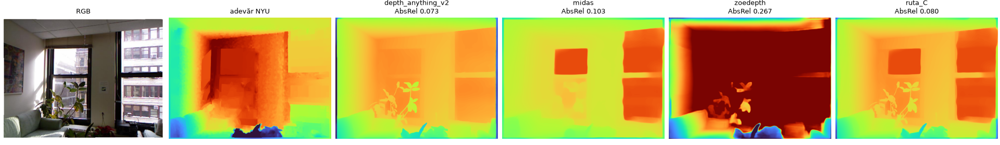

# OOVIRI – Ocluzia obiectelor virtuale în imagini reale folosind estimarea adâncimii

În realitatea augmentată, obiectele virtuale sunt desenate peste imagine chiar și când ar trebui ascunse în spatele unui obiect real mai apropiat. Proiectul estimează adâncimea scenei dintr-o singură imagine și decide, pixel cu pixel, ce e în față. Pentru că niciun model de adâncime nu e corect peste tot, decizia se ia prin votul a trei modele.

```
Imagine RGB → 3 modele de adâncime → aliniere în metri → vot / fuziune → ocluzie → imagine AR
```

**Echipa**
- P1: adâncime, vot, evaluare, demonstrator
- P2: compunere, ocluzie, vot, demonstrator

## Partea P1

### Ce s-a realizat

- **Cele 3 modele de adâncime rulează local, pe GPU:** Depth Anything V2 Small, MiDaS (DPT-Large) și ZoeDepth (NYU-KITTI).
- **Toate dau adâncime în metri.** ZoeDepth e metric. Depth Anything V2 și MiDaS dau disparitate relativă (fără unitate), care se aliniază la metri prin scară + offset (cele mai mici pătrate), pe adevărul NYU sau, pentru fotografii proprii, pe ZoeDepth.
- **Corecție pentru ZoeDepth:** padding-ul implicit din Hugging Face supraestima adâncimea cu ~25%; e dezactivat.
- **Ruta C – fuziune la nivel de adâncime:** mediana per pixel a celor 3 hărți aliniate.
- **Evaluare automată** pe toate cele 654 de imagini de test NYU Depth V2: AbsRel, RMSE, δ1 și timpul pe imagine, în crop-ul Eigen (ca în articole), în două moduri de aliniere.
- **Setul de date și modelele se descarcă automat** (un script pentru date, modelele la prima rulare).

### Rezultate (NYU Depth V2, 654 de imagini de test)

| Metodă | Aliniere | AbsRel ↓ | RMSE (m) ↓ | δ1 ↑ | s/imagine |
| --- | --- | --- | --- | --- | --- |
| Depth Anything V2 | adevăr | 0,086 | 0,365 | 0,935 | 0,019 |
| MiDaS | adevăr | 0,105 | 0,439 | 0,895 | 0,034 |
| ZoeDepth | – (metric) | 0,084 | 0,332 | 0,936 | 0,067 |
| **Ruta C** | adevăr | **0,075** | **0,327** | **0,950** | 0,121 |
| Depth Anything V2 | ZoeDepth | 0,105 | 0,432 | 0,893 | 0,019 |
| MiDaS | ZoeDepth | 0,122 | 0,487 | 0,853 | 0,034 |
| Ruta C | ZoeDepth | 0,094 | 0,382 | 0,916 | 0,121 |

↓ mai mic e mai bine, ↑ mai mare e mai bine. Timpii sunt măsurați pe un RTX 5090.

- Cu aliniere pe adevăr, **ruta C e mai bună decât fiecare model luat separat**, la toate metricile.
- Cu aliniere pe ZoeDepth (cazul fără adevăr), ruta C e mai slabă decât ZoeDepth singur: eroarea lui de scară se transmite tuturor celor trei hărți. Pe fotografii proprii, veriga slabă e alinierea.
- ZoeDepth la noi: AbsRel 0,084 față de 0,077 raportat în [articol](https://arxiv.org/abs/2302.12288).

### Exemple

Albastru = aproape, roșu = departe; aceeași scală de culori în tot panoul.

**Ruta C mai bună decât fiecare model** (AbsRel 0,051 față de 0,054–0,061):


**Mediana corectează un model care greșește:** ZoeDepth vede fereastra mult prea departe (AbsRel 0,267), ruta C rămâne aproape de adevăr (0,080):



### Urmează

- **Evaluarea ocluziei:** IoU și F1 pe măștile obținute cu compunerea P2; ponderile pentru ruta B.
- **Demonstrator (backend):** `run_pipeline(imagine, x, y, Z, metodă)`, care rulează tot lanțul pentru o imagine și întoarce imaginea fără ocluzie, cu ocluzie și timpul. Interfața e partea P2.
- **Grafice finale:** acuratețe față de viteză, pentru fiecare model și fiecare rută.
- **Bonus – video:** ocluzie pe fiecare cadru, cu medie exponențială a adâncimii între cadre, pentru o imagine stabilă.

## Partea P2

_De completat de P2._

## Instalare și rulare

```bash
python -m venv .venv
.venv\Scripts\activate
pip install torch torchvision --index-url https://download.pytorch.org/whl/cu132
pip install -r requirements.txt
python scripts/download_nyu.py
```

Setul de test NYU (~1 GB) se descarcă o singură dată în `data/`. Modelele (~2,7 GB) se descarcă singure în `models/` la prima rulare.

```bash
python -m depth.run data/nyu_test --out outputs   # hărți .npy + PNG + panouri, pe un folder de imagini
python -m evaluation.run                          # evaluarea pe 654 de imagini -> outputs/eval_depth.csv
jupyter notebook notebooks/depth.ipynb            # același lucru, interactiv
```

Pe fotografii proprii: un folder cu imagini JPG/PNG, fără `_depth.png` lângă ele; alinierea se face atunci pe ZoeDepth.

## Structură

```
depth/models.py        cele 3 modele: estimate_depth(imagine, model) -> adâncime în metri
depth/align.py         alinierea: disparitate relativă -> metri
depth/run.py           rulare pe un folder de imagini
fusion/voting.py       ruta C (aici vin și rutele A, B)
evaluation/metrics.py  AbsRel, RMSE, δ1 în crop-ul Eigen
evaluation/run.py      evaluarea pe NYU test -> CSV
scripts/download_nyu.py  descărcarea setului de date
notebooks/             notebook Jupyter
figures/               imaginile din README
data/, models/, outputs/  locale, ignorate de Git
```

## Date și modele

- Date: [NYU Depth V2](https://cs.nyu.edu/~silberman/datasets/nyu_depth_v2.html), subsetul de test (654 de imagini), preluat din [sayakpaul/nyu_depth_v2](https://huggingface.co/datasets/sayakpaul/nyu_depth_v2) (split `validation`).
- Modele (Hugging Face): [Depth Anything V2 Small](https://huggingface.co/depth-anything/Depth-Anything-V2-Small-hf), [MiDaS DPT-Large](https://huggingface.co/Intel/dpt-large), [ZoeDepth NYU-KITTI](https://huggingface.co/Intel/zoedepth-nyu-kitti).
